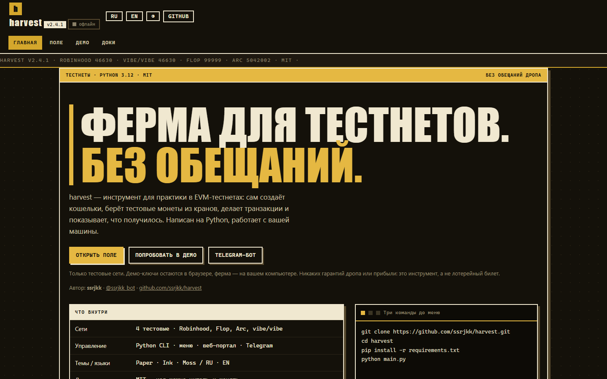
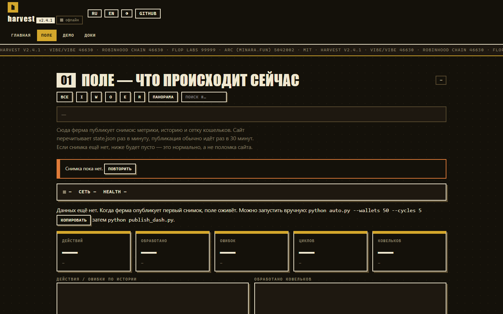
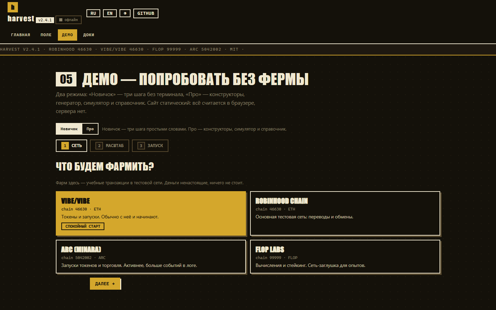
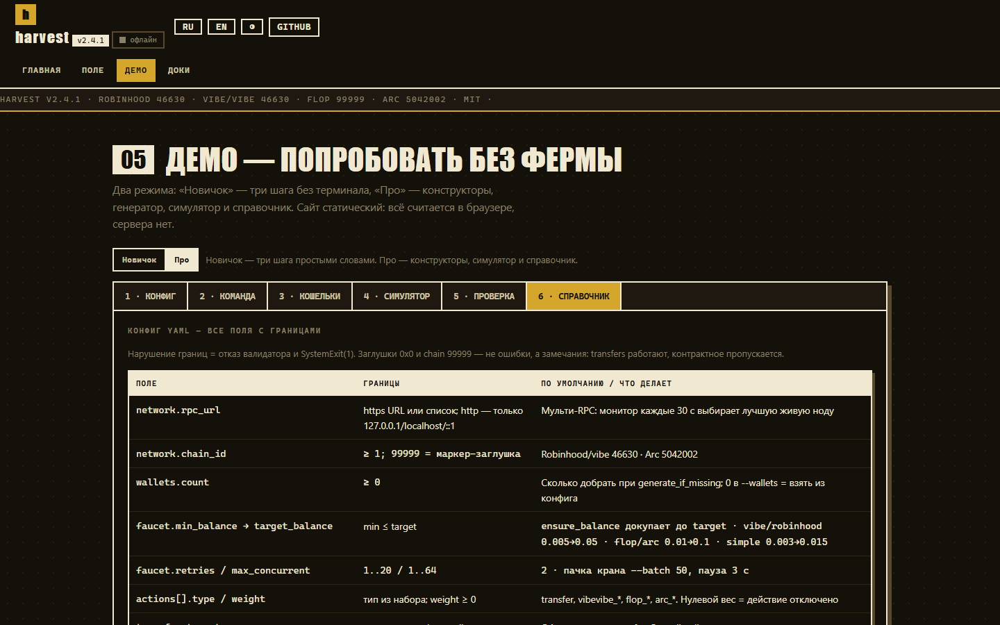

# harvest v2.4.1

[](https://github.com/ssrjkk/harvest/actions/workflows/ci.yml)
[](LICENSE)

**Автор:** [ssrjkk](https://t.me/ssrjkk_bot) · © 2026 ssrjkk

harvest — инструмент для практики в EVM-тестнетах: создаёт кошельки,
берёт тестовые монеты из кранов, делает транзакции и показывает, что
получилось. Есть веб-портал и Telegram-бот, чтобы не держать всё в консоли.

Только тестовые сети. Проект не обещает дроп, поинты или прибыль: тестнет
может закрыться, правила могут поменяться, активность могут не засчитать.
Это песочница для практики, а не способ заработать.

Python 3.12 · Windows/PowerShell (первичная цель — exe-дистрибутив через
PyInstaller) · [полная документация](DOCUMENTATION.md)


## Сайт

Сайт проекта: **[ssrjkk.github.io/harvest](https://ssrjkk.github.io/harvest/)** —
четыре страницы: «Главная» (зачем всё это, сети, спокойный быстрый старт),
«Поле» (метрики из `state.json`, PnL последнего прогона, кран, бот),
«Демо» (режимы «Новичок» — мастер за три шага, и «Про» — конструктор
конфига и команд, генератор кошельков, симулятор фарма, проверка конфига,
справочник параметров), «Доки» (архитектура, портал, безопасность, проверки,
лицензия). Темы Paper/Ink/Moss, языки RU/EN.

## Screenshots

| Хиро | Поле |
|---|---|
|  |  |

| Мастер новичка | Про-справочник |
|---|---|
|  |  |

Метрики поля публикует `python publish_dash.py` с машины фермы в
изолированную ветку `gh-pages` (один amend-коммит, история `main`
не растёт): рядом со `state.json` публикуется шифрованный
`wallets.enc.json` (AES-256-GCM, ключ `WALLETS_KEY` только в env) —
облачный BotForge-бот читает кошельки оттуда без нового провайдера.
В `state.json` попадают и **агрегаты PnL последнего прогона** (успешных
действий, Δ баланса по фарму и крану, причины отказов) — только счётчики,
без адресов кошельков; детальный отчёт с разбивкой по кошелькам и ссылками
на эксплорер ферма пишет локально в `pnl_report.html`.
Проверка сайта одной командой: `python tools/verify_site.py`,
скриншоты: `python tools/shoot_site.py`, матрица адаптивности (375/768/1440 ×
3 темы × 2 языка, горизонтальный скролл, бургер, ошибки JS):
`python tools/shoot_site.py --matrix` — тот же прогон гоняет CI.

## Быстрый старт

```powershell
pip install -r requirements.txt
python main.py                 # интерактивное меню (сеть → фарм)
python auto.py --wallets 3     # авто-режим: 3 кошелька, бесконечно (--cycles 5 — 5 циклов)
python auto.py --doctor        # самодиагностика
```

### Сети (тестнеты)

| Сеть | Конфиг | chain_id | Валюта |
|---|---|---|---|
| Robinhood Chain | [config_robinhood.yaml](config_robinhood.yaml) | 46630 | ETH |
| Flop Labs | [config_flop.yaml](config_flop.yaml) | 99999 (заглушка) | FLOP |
| Arc (Minara.Fun) | [config_arc.yaml](config_arc.yaml) | 5042002 | ARC |
| vibe/vibe (Robinhood testnet) | [config_vibevibe.yaml](config_vibevibe.yaml) | 46630 | ETH |

Пресет «только трансферы» для пачного фарма без контрактных адресов —
[config.simple.yaml](config.simple.yaml) (одна сеть Robinhood, отдельная БД
`farming_simple.db`, `gas_limit: 21000`):

```powershell
python auto.py --config config.simple.yaml --wallets 200 --cycles 2
```

vibe/vibe — permissionless token launchpad на Robinhood Chain testnet.
Контракты верифицированы в Blockscout, ABI — в `abi/vibevibe.json`
(VibePassMarket, VibeLoungeRegistry, VibeShop, VibeItems, VibeFuelStaking,
VibeFuelRewards). Реализован EIP-712 флоу `buy`/`sell` на VibePassMarket
(подпись TradeIntent ключом `tradeSigner` из `vibevibe.signer_key` / env
`FARMER_VIBE_SIGNER_KEY`) и `registerLounge` (только `REGISTRAR_ROLE`
платформы). Без ключа подписи buy/sell пропускаются; всегда работают
`transfer` / `claimRewards` / `stake`:

```powershell
python auto.py --config config_vibevibe.yaml --wallets 50 --cycles 5
```

Базовый шаблон для своего конфига — [config.example.yaml](config.example.yaml).

### Авто-режим (CLI)

```powershell
python auto.py                                # 50 кошельков, циклы бесконечно
python auto.py --wallets 200 --cycles 5
python auto.py --skip-faucet --skip-farm
python auto.py --schedule 6                   # пайплайн каждые 6 часов
python auto.py --history 20 / --doctor / --version
```

Полная таблица флагов, фазы пайплайна и поведение крана — в
[§2.2 DOCUMENTATION.md](DOCUMENTATION.md).

### Портал (веб + Telegram)

```powershell
pip install -r requirements-portal.txt
python -m portal                # aiohttp + API + Telegram-бот (env-конфигурация ниже)
```

Веб-дашборд и Telegram-бот: мониторинг метрик (циклы, действия, ошибки,
health, количество кошельков), старт/стоп/пауза фермы, история циклов,
топ кошельков и **экспорт всех кошельков с ключами** (CSV/JSON) — в вебе
кнопкой «Скачать кошельки», в боте `/export` или кнопкой меню.
Бот также умеет `/cmd` (готовая команда), `/cfg` (готовый YAML файлом),
`/check` (проверка YAML) и `/ref` (справочник) — в стиле сайта.

Локальная веб-панель (FastAPI + WebSocket-лог, без Telegram): пункт `G`
в меню `main.py` → http://127.0.0.1:8080 (`core/web_gui.py`).
Основной портал (aiohttp + Telegram-бот + Mini App) — тот же `127.0.0.1:8080`
(`portal/`): запускайте только одну панель за раз.

Секреты — только через env (`PORTAL_SECRET`, `GOOGLE_CLIENT_ID/SECRET`,
`TELEGRAM_BOT_TOKEN`, `FARMER_MASTER_KEY`, `WALLETS_KEY` и др.) — та же таблица env в
[§4.1 DOCUMENTATION.md](DOCUMENTATION.md).

### Сборка exe

```powershell
pip install -r requirements.txt
pyinstaller harvest.spec --noconfirm --clean   # либо build.bat
Unblock-File dist\harvest\harvest.exe
```

## Структура

```
auto.py        — CLI-автомат (4 фазы пайплайна)
main.py        — интерактивное меню (Rich)
config_*.yaml  — конфиги сетей (robinhood/flop/arc/vibevibe) + config.simple.yaml,
                 config.example.yaml — шаблон
core/          — ядро: config, network (мульти-RPC/EMA/1559-фоллбэк),
                 pool/farmer/workpool, vibevibe (ABI), crypto, database,
                 web_gui (локальная FastAPI-панель)
portal/        — aiohttp-портал + API + Telegram-бот + Mini App (+networks.py)
tests/         — pytest-набор (test_load_opt.py — нагрузка, opt-in)
docs/          — сайт: index.html (Главная), field.html (Поле), demo.html (Демо),
                 docs.html (Доки) + assets/ (CSS и common/field/demo JS),
                 sw.js, screenshots/ → ssrjkk.github.io/harvest
tools/         — verify_site.py (проверка сайта), shoot_site.py (скриншоты)
abi/           — ABI-контракты (vibevibe.json, flop.json, arc.json)
harvest.spec   — спецификация PyInstaller (сборка: build.bat)
publish_dash.py — публикация state.json + шифрованного wallets.enc.json поля в ветку gh-pages
```

Архитектура каждого модуля — [§3 DOCUMENTATION.md](DOCUMENTATION.md).

## Безопасность

Секреты шифруются (AES-256-GCM), запись seed-данных без master-ключа
запрещена (fail-closed), краснение RPC-URL, license-hub гейт,
portal default-deny + fail-closed. Подробно — [§6 DOCUMENTATION.md](DOCUMENTATION.md).

## Тесты

```powershell
python -m pytest tests -q
```

Полный прогон, включая контуры `wait_for_receipt`: EMA-бюджет поллинга,
RPC-failover при серии ошибок, деградация частоты опроса, `None` по истечении
бюджета без отката nonce, кросс-чек статуса на вторичной ноде. В CI также
идут ruff, bandit и покрытие portal/core на 100%.

Нагрузка — opt-in, в обычном CI пропускается:

```powershell
$env:HARVEST_LOAD=1; python -m pytest tests/test_load_opt.py -q
```

## Развёртывание (VPS / Docker)

Готовый deploy-кит для Linux-сервера (Docker + compose, Telegram-бот на long-polling
без публичного URL, Caddy для домена+HTTPS позже) — в каталоге [`deploy/`](deploy/README.md):
`.env`-шаблон секретов, healthcheck, volume для данных, инструкция по добавлению бота
и переходу на публичный HTTPS.

## Автор и поддержка

Проект создан и поддерживается **ssrjkk**.

- Telegram-бот автора: [@ssrjkk_bot](https://t.me/ssrjkk_bot)
- Telegram-бот фермы: [@harvest_testnet_bot](https://t.me/harvest_testnet_bot)
- Репозиторий: [github.com/ssrjkk/harvest](https://github.com/ssrjkk/harvest)

Лицензия — [MIT](LICENSE), Copyright © 2026 ssrjkk.
