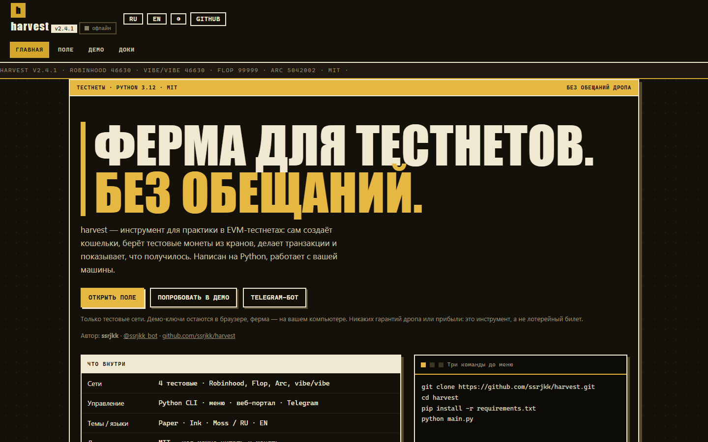

# Harvest

> **Languages:** [English](README.md) · [Русский](README.ru.md)

QA stand for EVM testnets: wallet fleets with behavioral profiles, transaction
scenarios, network health metrics and run reports. It includes a web portal and a
Telegram bot. The full Russian documentation is in [README.ru.md](README.ru.md).

**Site:** https://ssrjkk.github.io/harvest/  
**Bot:** https://t.me/harvest_testnet_bot  
**Source:** https://github.com/ssrjkk/harvest

## Screenshot



Testnets only. The project does not promise airdrops, points or profit; networks can
close and activity may not be counted.

## Features

- Smoke, load, soak and chaos scenarios.
- Multi-wallet execution with configurable concurrency and cycles.
- Multi-RPC failover, EIP-1559 fallback and faucet handling.
- Local and published dashboards with PnL aggregates and health metrics.
- Telegram control, history, configuration helpers and wallet export.
- Optional encrypted wallet publication for a cloud bot.
- Windows-first CLI and PyInstaller distribution.

## Quick start

```powershell
pip install -r requirements.txt
python main.py
python auto.py --wallets 3 --cycles 5
python auto.py --doctor
```

Use `config.example.yaml` as the base for a network configuration. The repository
also contains network-specific configs and a transfer-only preset.

## Portal

```powershell
pip install -r requirements-portal.txt
python -m portal
```

The portal runs on http://127.0.0.1:8080. Configure `PORTAL_SECRET`,
`TELEGRAM_BOT_TOKEN`, `FARMER_MASTER_KEY` and `WALLETS_KEY` through environment
variables. Never commit wallet keys or bot tokens.

## Checks

```bash
python tools/verify_site.py
pytest -q
```

For responsive screenshots across viewports, themes and languages:

```bash
python tools/shoot_site.py --matrix
```

## Documentation

- [Russian README](README.ru.md)
- [Full documentation](DOCUMENTATION.md)
- [Site docs](https://ssrjkk.github.io/harvest/docs.html)
- [Demo](https://ssrjkk.github.io/harvest/demo.html)
- [Security policy](SECURITY.md)

## License

MIT — see [LICENSE](LICENSE).
